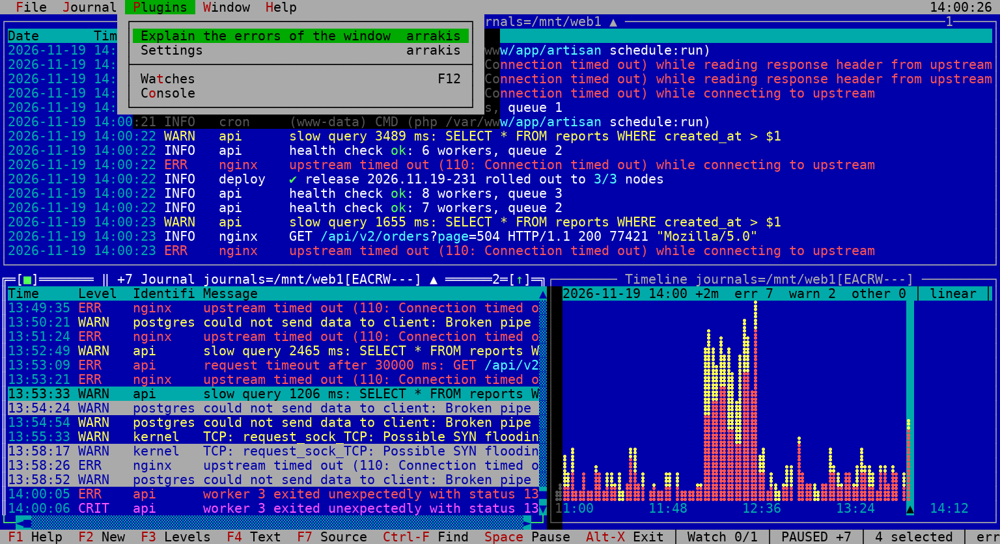

# TurboJedi

Turbo Journald Interface (J[e]DI) — a Turbo Vision viewer of the systemd journal. Every window is a journal client of its own:
its filter goes to the journal as a query, so a window of one unit or of errors only reads just those
entries, while other windows follow the whole system next to it.

It is scriptable in Lua 5.4: plugins make the Actions menu of an entry and watch the journal as it comes, see
[PLUGINS.md](PLUGINS.md). It is open to AI agents as well: `turbojedi-mcp.py`, a server of the Model Context Protocol,
gives Claude Code, Codex or another agent the windows you have open, over SSH; the agent finds and points at entries
on your screen, you act, see [MCP.md](MCP.md).

Built on [magiblot/tvision](https://github.com/magiblot/tvision), libsystemd, PCRE2, Lua 5.4 and libcurl.



## Features

- Windows with journals and filters of their own: journals of this machine, of every machine or of a directory,
  one mounted from another machine over SSH or NFS as well,
  levels, source (unit, identifier, command, transport, boot, user, machine, PID,
  any `FIELD=VALUE`), time range, and text, plain or a regular expression of PCRE2, to show or to leave out
- Follows the tail, Space pauses; scrolling past the oldest line brings the older entries in. The title of every
  window tells it: ► follows, ‖ is paused, ‖ +12 has 12 entries come meanwhile; a click on the sign pauses or follows.
  A paused window that is full keeps
  its lines and marks, the new entries are counted and come in when it follows again
- The newest entries at the bottom or on top, like `journalctl --reverse`, for every window of its own; the lines of
  a message stay under it, the title ends with ▲ or ▼ and a click on it turns the order
- Columns to choose: date, time, level, host, unit, identifier, PID; UTC, milliseconds, wrapped messages, hidden heading,
  the newest on top
- Highlighting of messages by rules: built-in ones for times, addresses, identifiers, paths, quoted text, key=value
  and the words that matter, or any rule file of [grc](https://github.com/garabik/grc); colors of the escape sequences
  a message comes with are shown under the rules, the rest of the sequences are taken out
- Find with highlighting, next and previous, on into the older entries past the oldest line
- Clone of a window with its lines, filter, selection and place: one stays where it is, the other goes elsewhere;
  a timeline is cloned with its counts, step and scale
- List of the windows to go to, narrowed down by a filter
- Go to a time, and every other window to the time of the selected line: what happened elsewhere at that moment
- Details of an entry with all its fields, a field there opens a window narrowed to it
- Actions of an entry by plugins in Lua 5.4: Alt-F10, A, F11, Shift-F10 or a right click opens the menu of what the
  plugins offer for it, each item named with its plugin. The plugins of the package: the status of the unit of the
  entry, its state told in the menu, its unit file and its process in htop or top, the route, lookup, whois, ping and
  path of an address, a core dump in coredumpctl and gdb, a ban in fail2ban after a confirmation, the marked entries
  explained by a language model of your choice (Arrakis, below); the attacks on the
  SSH server in a watch, block devices, Asterisk, alerts and a chat are in the examples. Plugins ask with dialogs, run
  commands in the background, in a window or on the terminal, ask web services over HTTP, call services over D-Bus
  with typed values and keep sockets and timers going, see [PLUGINS.md](PLUGINS.md)
- Watches of plugins: entries of a filter as they come, a status and lines of each in a list, F12; Watch 1/3 * in the
  status line tells about new ones, an important one brings the list up with a bell
- AI agents: every instance offers its workspace on the system bus, and `turbojedi-mcp.py` gives it to an agent such
  as Claude Code or Codex over SSH: the windows, the entry under the cursor, the marked entries, queries of the journal
  and the watches. The agent marks entries, puts the cursor on one, takes a window to a moment or opens one, the status
  line tells it; it runs nothing, the user acts. See [MCP.md](MCP.md), the interface itself in [DBUS.md](DBUS.md)
- Selection with the keyboard or the mouse, copy to the clipboard (OSC 52 over SSH), export to a file
- Timeline: entries of the filter of a window by intervals of time, errors, warnings and the rest stacked
  in a column per interval; a column takes every journal window to its time
- Layouts: all windows with their filters, columns and places, saved to and opened from INI files;
  the last one comes back on the next start
- Check for updates in the Help menu: asks GitHub for the latest release only when chosen, shows it
  with the command of the install script; nothing goes to the network otherwise. Its answer has the choice
  of a check on start, once a day and only about a newer release, kept in `$XDG_CONFIG_HOME/turbojedi/update.conf`;
  the first start without that file asks for the choice once, Yes or No. Under `sudo` it is the file of your home,
  written as you, so root asks nothing you have answered already

## Installation

Ready packages of every release are on the [releases page](https://github.com/cyanide-burnout/TurboJedi/releases/latest):
Debian 12 and 13, Ubuntu 22.04, 24.04 and 26.04, Fedora 44, RHEL 9 and 10 (and their rebuilds), Amazon Linux 2023,
openSUSE Tumbleweed and Leap 16 on amd64 and arm64, Arch Linux on amd64. GitHub Actions builds each of them in a container
of its distribution. The script takes the one that fits:

```
curl -fsSL https://raw.githubusercontent.com/cyanide-burnout/TurboJedi/master/install.sh | sh
```

It asks for sudo when not run as root, `TURBOJEDI_VERSION=0.6` before `sh` takes that release instead of the latest one.
Run again, it updates TurboJedi and leaves it alone when that release is installed already. After an upgrade of the
distribution it puts the package of the same release built for the new one; Check for updates tells about it as well.
Raspberry Pi OS of 64 bits is Debian on arm64 and has packages; on 32 bits (armhf) TurboJedi builds from the sources.
By hand:

```
sudo apt install ./turbojedi_<version>_<distribution>_<arch>.deb
sudo dnf install ./turbojedi-<version>-1.<dist>.<arch>.rpm
sudo zypper install --allow-unsigned-rpm ./turbojedi-<version>-1.<tumbleweed|leap16>.<arch>.rpm
sudo pacman -U turbojedi-<version>-1-x86_64.pkg.tar.zst
```

Alpine has no systemd, so there is no journal to show. Elsewhere TurboJedi builds from the sources.

## Building

Debian packages: `build-essential cmake pkg-config libsystemd-dev libncurses-dev libpcre2-dev liblua5.4-dev libcurl4-openssl-dev`,
`libgpm-dev` for the mouse in the Linux console, and `grc` for its rule files if they are wanted

```
git submodule update --init
make
sudo make install
```

A clone is updated with its submodule, a plain `git pull` leaves tvision where it was until
`git submodule update --init`:

```
git pull --recurse-submodules
make
```

`make` builds tvision in `Import/tvision/build` first, and again what has changed in it after the submodule has
moved. `make install` puts the executable to `/usr/local/bin`, the manual page to `/usr/local/share/man/man1` and the
plugins to `/usr/local/share/turbojedi`, `PREFIX` and `DESTDIR` move them. Without libgpm the build goes on, with the mouse in terminal emulators only; the mouse
of the Linux console needs the `gpm` service running.
libcurl serves Check for updates and the requests of plugins. Lua 5.4 is needed; distributions name its pkg-config module in
their own ways, `lua5.4`, `lua54` or `lua`, any of them of version 5.4 is taken.

About, `--help` and Check for updates link to the repository on GitHub the clone comes from, its `origin`, so a fork links
to itself and checks its own releases. A copy without git or a clone of another host has none, `make REPOSITORY=` leaves
it out on purpose and `make REPOSITORY=https://github.com/owner/name` names another one.

### Debian package

```
sudo apt install debhelper
make deb
```

`make deb` builds `turbojedi_<version>_<arch>.deb` and its `-dbgsym` next to the directory of the project, with
the files in `/usr`. The version comes from `git describe` the way the program shows it: `v0.1-3-gabcdef` becomes
`0.1+3+gabcdef`.

`make deb DISTRIBUTION=amd64` builds for another architecture, with the cross compilers and the libraries of
that architecture in place:

```
sudo dpkg --add-architecture amd64
sudo apt update
sudo apt install crossbuild-essential-amd64 libsystemd-dev:amd64 libncurses-dev:amd64 libpcre2-dev:amd64 libgpm-dev:amd64 libcurl4-openssl-dev:amd64 liblua5.4-dev:amd64
```

### RPM package

```
sudo dnf install rpm-build gcc-c++ make cmake systemd-devel ncurses-devel pcre2-devel gpm-devel libcurl-devel lua-devel
make rpm
```

`make rpm` builds `rpmbuild/RPMS/<arch>/turbojedi-<version>-1.<dist>.<arch>.rpm` for Fedora, RHEL and Amazon Linux,
with the version the same way. RHEL 9 and its rebuilds have `lua-devel` in CRB: `sudo dnf config-manager --set-enabled crb`. openSUSE takes the same
packages from `zypper` with `lua54-devel` and `gcc-PIE`, gives no tag of its own
and gets it by `make rpm DIST=tumbleweed` or `DIST=leap16`.

### Arch Linux package

```
sudo pacman -S --needed base-devel cmake git pkgconf gpm curl lua54
make arch
```

`make arch` builds `arch/turbojedi-<version>-1-<arch>.pkg.tar.zst` with `makepkg`, as a user other than root.

### Packages of a release

A tag `v*` makes GitHub Actions build all the packages and put them to its release. The notes of the release are the
section of [CHANGELOG.md](CHANGELOG.md) for its version, written before the tag.

## Usage

```
turbojedi [options] [FIELD=VALUE ...]
```

| Option | |
|---|---|
| `-t`, `--identifier ID` | entries of `SYSLOG_IDENTIFIER` |
| `-u`, `--unit UNIT` | entries of a systemd unit, `.service` is assumed without a suffix |
| `-U`, `--user USER` | entries of a user, by name or number |
| `-p`, `--priority LEVEL` | entries up to `LEVEL`: `emerg` … `debug` or `0` … `7` |
| `-k`, `--kernel` | kernel messages only |
| `-S`, `--since TIME` | entries from `TIME` on |
| `--until TIME` | entries up to `TIME` |
| `-b`, `--boot` | entries of the current boot |
| `-D`, `--directory DIR` | journal files of `DIR` in the first window |
| `-m`, `--merge` | journals of every machine there are in the first window, like `journalctl --merge`: other machine IDs in `/var/log/journal` and `/var/log/journal/remote` of `systemd-journal-remote` |
| `-n`, `--lines N` | history to start with, 1000 by default |
| `-r`, `--reverse` | the newest entries on top in the first window, like `journalctl --reverse` |
| `-H`, `--highlight NAME` | highlighting rules: `builtin` (default), `off`, a rule file of grc such as `conf.log`, or a path |
| `-c`, `--layout FILE` | windows of a saved layout |
| `--clipboard-copy COMMAND` | command of `sh` that takes copied lines on its standard input, over `$TURBOJEDI_CLIPBOARD_COPY` |

`TIME` is `2026-10-23 19:00[:00[.000000]]`, `2026-10-23`, `19:00`, `now`, `today`, `yesterday`, `tomorrow` or a relative
one as journalctl takes it: `-1h`, `+30m`, `-1h 30min`, `-2days`, `5min ago` (`us`, `ms`, `s`, `min`, `h`, `d`, `w`,
`M`, `y` and their longer names); in local time, or in UTC with `UTC` at the end as journalctl takes it:
`2026-10-23 17:00 UTC`.

Reading the whole journal needs root or the `systemd-journal` group, others see their own entries only.

Copy (Ctrl-Ins, and Copy in the details) goes to the clipboard of the terminal by OSC 52 or to a clipboard tool
of the desktop. A command of your own takes the lines instead, such as `remote-copy.sh` of
[RemoteClipboard](https://github.com/cyanide-burnout/RemoteClipboard) that brings them home over an SSH socket:

```
export TURBOJEDI_CLIPBOARD_COPY="$HOME/remote-copy.sh"
turbojedi
```

or once and for all in `~/.config/turbojedi/clipboard.conf`, a line of its own:

```
copy = /home/you/remote-copy.sh
```

The option goes over the environment, the environment over the file. The file is read only when it is a regular
file of your own, not a link.

When the command exits with an error or does not finish in 3 seconds, the clipboard of the terminal takes the
lines as usual. Input lines of the dialogs keep the clipboard of Turbo Vision, pasting is up to the terminal.

Under `sudo` the clipboard still belongs to you: `sudo turbojedi` takes `clipboard.conf` of your home and runs its
command as you, with your groups, `HOME`, `USER` and `LOGNAME`, never as root; what you have written there is no
more than you can run yourself. `sudo` leaves `TURBOJEDI_CLIPBOARD_COPY` out of the environment, so the file is the
way. A command given by the option or kept by `sudo -E` runs as root, as before, and goes back to your user by itself:

```
sudo turbojedi --clipboard-copy "sudo -u $USER $HOME/remote-copy.sh"
```

Your shell puts in `$USER` and `$HOME` before `sudo` starts.

## Journals of other machines

A journal directory mounted from another machine opens with `-D` or Shift-F7 like any other directory, with the filters,
the history, the timeline, the details and Alt-G. `/var/log/journal` opens as it is, with the directories of machine IDs
in it; a machine that keeps its journal in memory only (`Storage=volatile`) has it in `/run/log/journal`. A network file
system or FUSE tells nothing about appended entries and new files, TurboJedi looks at the files every second instead and
opens the journal again after a rotation.

Over SSH with sshfs, as a user of the group `systemd-journal` on that machine or as root:

```
mkdir -p ~/journals/web1
sshfs -o ro,reconnect,cache=no,ServerAliveInterval=15 admin@web1:/var/log/journal ~/journals/web1
turbojedi -D ~/journals/web1
fusermount -u ~/journals/web1
```

`cache=no` lets the appended entries in at once, sshfs keeps what it knows about a file for 20 seconds otherwise and they
come in by those steps. With `reconnect` the files open before the connection broke cannot be read anymore, the windows
open their journals again when it is back and go on after their last lines.

Over NFS, exported read-only by that machine in `/etc/exports`:

```
/var/log/journal  monitor.example.com(ro,no_subtree_check)
```

and mounted where TurboJedi runs:

```
sudo mkdir -p /mnt/journals/web1
sudo mount -t nfs -o ro web1:/var/log/journal /mnt/journals/web1
turbojedi -D /mnt/journals/web1
```

The files are `root:systemd-journal` with mode 0640 and NFS compares numbers: the user who reads them needs a group with
the GID `systemd-journal` has on that machine, root reads them only with `no_root_squash` in the export. A mount of NFS is
`hard` unless told otherwise: while the server is away, and during its grace period of 90 seconds after a start, the windows
wait for it the way every program on that mount does, and go on when it answers.

A window per machine, each with its directory chosen by Shift-F7, puts several machines side by side: Alt-G takes every
window to the time of the selected line, and a layout keeps their directories for the next start.

## Keys

| Key | |
|---|---|
| F1 | keys |
| F2 | new window with the filter of the command line |
| Shift-F2 | clone of the focused window: its lines, filter, find, selection and place, or the counts, step, scale, bars and cursor of a timeline; both go on with the journal on their own |
| F3 | levels |
| F4 | text filter |
| F7 | source |
| Shift-F7 | journals: of this machine, of every machine or of a directory |
| Ctrl-T | time range, in local time or with UTC checked in UTC: checking it turns the times over to the same moments, `today` to the date and time of its midnight, and back to `today` with nothing typed meanwhile; it starts in the zone the range is written in, or as the window shows times when nothing in the range is of a zone |
| Ctrl-K | columns |
| Ctrl-W | wrap long messages |
| Ctrl-R | the newest entries on top or at the bottom; the title ends with ▲ when they are at the bottom, ▼ when on top, a click on it turns the order too |
| Ctrl-L | highlighting rules |
| Ctrl-F, Ctrl-N, Ctrl-P | find, next, previous |
| Ctrl-G | go to a time, the one of the line at hand in the zone the window shows |
| Alt-G | every other window goes to the time of the selected line |
| Ctrl-Z | undo navigation: back along the moves of the window, every move of the cursor by the keys or the mouse, Ctrl-G, Alt-G and a find, the last 64 of them; marks and lines are not undone; also Alt-Left and Alt-Backspace |
| Ctrl-Y | redo navigation: forward again where Ctrl-Z has come from, also Alt-Right; a new move after Ctrl-Z drops the way ahead |
| Alt-T | timeline: entries of the filter of the window by intervals of time; Left and Right move, Enter takes every journal window to the interval, `+` and `-` change the step, `L` the scale, `B` the bars: blocks, or Braille dots with two intervals a cell, `U` hours and days of UTC or of the local zone, as the window shows times at first. Shift with the arrows, dragging or Shift+click select intervals, `Z` or a double click in the selection zooms into it, Ctrl-T sets the range, Ctrl-Z or a right click and Ctrl-Y go back and forward along the ranges and the steps with the cursor; intervals of hours above one and of days go by the wall clock, a day the clocks change has 23 or 25 hours; the status line tells the keys, the heading the scale, the bars and the zone |
| Up, Down, PgUp, PgDn, Home, End | move the cursor, it starts on the newest line of the screen; on the newest line the window follows, anywhere else it pauses |
| Enter, double click | details of the entry under the cursor, Enter on a field there opens a window with it added to the filter |
| Alt-F10, A, F11, Shift-F10, right click | actions of the plugins for the entry under the cursor, see [PLUGINS.md](PLUGINS.md); A is for Terminal of macOS, which keeps F10 and F11 for itself |
| Space | pause or follow, also a click on ► or ‖ in the title |
| Shift+arrows, mouse | select lines from the cursor, Esc drops the selection and the marks, the cursor stays |
| M, Insert | begin marking from the cursor, the keys mark the lines they pass; M again ends it and they stay marked, so lines apart are marked one stroke after another. Begun on a marked line it takes the marks off instead. No Shift is needed, which Terminal of macOS and some others keep for themselves |
| Click | put the cursor on a line, the marks stay; in a stroke of M the click goes on with it as the keys do. Ctrl+click marks a line or takes its mark off, Shift+click and dragging select |
| Ctrl-Ins | copy the selected lines or the line under the cursor |
| Ctrl-E | export the selected lines or all of them |
| F8 | clear the window |
| Ctrl-O, Ctrl-S | open, save a layout; both start at the layout opened or saved last, Save offers its file again |
| F5, Ctrl-F5, F6, F9, Alt-F3 | zoom, size, next, tile, close |
| Window → Console | the console of TurboJedi: `print()` and `log()` of the plugins, their errors, the problems of the start and what callers of D-Bus have done, a problem left unread; a watch of its own in F12 that stays, F8 in its lines clears them |
| Window → Shadows | of every window and dialog: off, light, medium as Turbo Vision has them, or dark; kept in `$XDG_CONFIG_HOME/turbojedi/screen.conf` whatever layout comes, under `sudo` the one of your home, written as you |
| Alt-0 | list of the windows to go to, the one used before is under the cursor |
| F12 | watches of plugins with their status, Enter shows the lines of one, Delete or Backspace removes it, U turns their times to UTC and back |
| Alt-X | exit |

## Layouts

A layout is an INI file with a `[journal]` section per window of the journal (`[window]` in older layouts):

```
[journal]
bounds = 0 0 120 28
unit = nginx.service
text = timeout
regex = yes
levels = EACRW---
highlight = conf.log
columns = date,time,level,identifier,pid,millisecond
```

Keys: `bounds`, `directory`, `merge`, `unit`, `identifier`, `command`, `transport`, `boot`, `user`, `machine`, `pid`, `match` (repeatable),
`since`, `until`, `text`, `regex`, `exclude`, `case`, `levels` (letters `EACRWNID` of the levels shown, dashes
for the hidden ones), `highlight` and `columns` (`date`, `time`, `level`, `host`, `unit`, `identifier`, `pid`, `utc`,
`millisecond`, `wrap`, `headless`, `reverse`).

A timeline is a `[timeline]` section with `bounds`, the keys of the filter it counts, `step` (seconds of an interval,
`0` lets the window choose one that fits), `scale` (`linear` or `log`), `bars` (`blocks` or `braille`) and `utc = yes` for hours and days of UTC; a zoomed
timeline keeps its range in `since` and `until`:

```
[timeline]
bounds = 0 28 120 42
unit = nginx.service
levels = EACRWNID
step = 3600
scale = log
bars = braille
```

The list of watches of plugins is a `[watchlist]` section with its `bounds`, the lines of a watch a `[watchlines]` section
with `bounds` and the `plugin` and `key` of the watch, which find it when the layout opens; a watch without a key is
found by its `title` and `index` among the watches of the same plugin and title in the order they have been set; the watches
themselves are kept by their plugins in a `[watches]` section, see [PLUGINS.md](PLUGINS.md), which has `utc = yes` when
their times are of UTC:

```
[watchlist]
bounds = 5 8 115 26

[watchlines]
bounds = 7 9 117 27
plugin = tetrapack
key = context:41d48349-56d6-4e73-b2b9-bb45e9df0c97
title = Context 41d48349-56d6-4e73-b2b9-bb45e9df0c97
```

## Highlighting

Rules are those of [grc](https://github.com/garabik/grc): `regexp=` with `colours=` for the match and its groups,
`count=once`, `more` or `stop`, entries apart by lines of `-` or `=`. Rule files come from `~/.grc`,
`/usr/local/share/grc` and `/usr/share/grc`, or by a path. Colors go over the color of the level, light ones for
the blue window; rules of several lines (`count=block`) and replacements are left out. The built-in rules are
written the same way in `Source/JournalHighlighter.cpp`.

## Plugins

The Actions menu of an entry, Alt-F10, A, F11, Shift-F10 or a right click, is made by plugins in Lua 5.4 from
`/usr/share/turbojedi/plugins`, `/usr/local/share/turbojedi/plugins` and `~/.config/turbojedi/plugins`. The package
brings these:

- `010-systemd.lua`: the status of the unit of the entry in a window or to the clipboard, its state and since when
  told in the title of the item by systemd over D-Bus, its unit file, its process in htop, or in top without it
- `020-network.lua`: an item for every address of the message, its route, lookup, whois, ping, path or a copy are chosen
  there, the ones whose programs are installed
- `030-coredump.lua`: for an entry of systemd-coredump, what coredumpctl knows of that dump, a copy of it, its stack in
  gdb
- `040-fail2ban.lua`, for root where fail2ban is installed: Ban and Unban of an address of the entry, after asking for
  the jail and a confirmation, never for an address of this machine
- `050-arrakis.lua`, where `arrakis.conf` tells a language model: the marked entries, or the entry and what has come
  before it, explained by the model; see [Arrakis](#arrakis) below

Plugins that change things, or that would come up by chance, are examples in `/usr/share/turbojedi/examples` and are not
run by themselves: `100-ssh.lua`, a watch of the attacks on the SSH server of this machine while TurboJedi is open, an
address a line with its failures and the user names it has tried, a login after failures or a flood of tries bringing
the list of watches up with a bell; `100-storage.lua`, the device, mounts, udev and SMART of a block device an
entry of the kernel or smartd names; `100-asterisk.lua`, the calls, channels, endpoints, AORs, modules and dialplan of an entry
of Asterisk, shown, traced in the journal, hung up or reloaded through `asterisk -rx`; `100-alert.lua`, watches of the
journal by rules of `~/.config/turbojedi/alert.conf`, while TurboJedi is open; `100-chat.lua`, the entry or the
marked ones sent to Slack, Mattermost, Rocket.Chat, Discord, Telegram or ntfy through a webhook told in
`~/.config/turbojedi/chat.conf`.

A link to an example turns it on and follows the updates of the package, for the whole machine:

```
sudo mkdir -p /usr/local/share/turbojedi/plugins
sudo ln -s /usr/share/turbojedi/examples/100-ssh.lua /usr/local/share/turbojedi/plugins/
```

or for one user alone:

```
mkdir -p ~/.config/turbojedi/plugins
ln -s /usr/share/turbojedi/examples/100-ssh.lua ~/.config/turbojedi/plugins/
```

TurboJedi reads plugins at start, it takes the plugin when started again. Removing the link takes it away, a link left
behind by a removed package is told about at start. A build installed by `make install` has the examples in
`/usr/local/share/turbojedi/examples`.

How to write a plugin: [PLUGINS.md](PLUGINS.md).

## AI agents

`turbojedi-mcp.py` is a server of the Model Context Protocol: an agent on your machine starts it over SSH and sees the
TurboJedi you have open on the server, its windows, cursor, marks, watches and the journal. The agent points, you act:
it marks entries, moves the cursor, takes a window to a moment or opens a window of its own, and `API: ...` in the
status line tells you so; it never runs the actions of the plugins or commands. With Python 3 and dbus-python on the
server:

```
claude mcp add turbojedi -- ssh server turbojedi-mcp.py
```

How to connect Claude Code, Codex or another client, and what to ask: [MCP.md](MCP.md). The interface on the system
bus, for scripts of your own: [DBUS.md](DBUS.md).

### Arrakis

On Arrakis they mine the spice; Arrakis of TurboJedi mines the sense of the journal. Mark entries, Actions → Arrakis:
explain N marked entries, or Arrakis: explain this entry, which takes along the 30 entries of its unit before it. A
language model behind an HTTP API tells what has happened, the likely cause and what to check; the answer comes up
in a window, stays in a watch "Arrakis N" of F12, and the entries it names are lines there that go to them by Enter.
TurboJedi goes on while the model thinks; Actions offers to cancel a job that goes on.

Under the answer is a line for a question about it, what a number of an error means for one: Ask sends it with the
entries, the answer and the questions before it, as a conversation of that job alone, and the answer comes the same
way, with a line for the next question; Close ends it. PgUp and PgDn scroll a long answer, Copy puts all of it to the
clipboard, a command in it whole. An answer cut at the limit of tokens says so: `tokens` of `arrakis.conf` gives more,
and a model that thinks first needs more of them. Enter or a double click on an answer or a question among the
lines of its watch in F12 brings it back; the questions and the answers are lines there as well. Every job starts on
its own, the model remembers nothing of the others.

Nothing happens without a file: `/etc/turbojedi/arrakis.conf` of root for every user, `~/.config/turbojedi/arrakis.conf`
of the user over it. Run by `sudo turbojedi`, the file in the home of the user who has run sudo goes over both, so the
same file serves TurboJedi run as yourself and as root.

```
url      = http://127.0.0.1:8080/v1/chat/completions
model    = qwen2.5-1.5b-instruct
# openai, or anthropic, which /v1/messages tells as well
format   = openai
# a token for a service that wants one: chmod 600 the file then
key      = ...
# of the answers, the one of the locale without it
language = ru
# characters of entries a request takes, the newest kept
budget   = 12000
# seconds a request may take, 0 for no limit
timeout  = 600
# tokens of an answer at most, the service decides without it, 2048 for Anthropic;
# a model that thinks first needs several thousand
tokens   = 2048
# instructions of your own instead of the ones built in, {language} there the language of the answers
prompt   = /etc/turbojedi/arrakis.prompt
# every answer with its request as a line of JSON, to teach a model of your own on
record   = /var/tmp/arrakis.jsonl
```

A line is `key = value` to its end, a comment is a line of its own that starts with `#`. `prompt` and `record` are for a
model of your own: `record` keeps what a large model has answered on your journals, a set to teach a small one on, and
`prompt` gives that small one the instructions it has been taught with. The record holds the entries: it is made with 0600, and
written only when it is a file of the user alone, not a link. Under `sudo`, `prompt` and `record` of your own file
are left out, and the console tells so: root reads and writes no path a user names, give them in
`/etc/turbojedi/arrakis.conf` then.

Any service of the API of OpenAI or of Anthropic does, on this machine or not:

| Engine | `url` |
|---|---|
| llama-server of llama.cpp | `http://127.0.0.1:8080/v1/chat/completions`; a model of 0.5–1.5B runs on the CPU of a VM of 2 GB |
| Ollama | `http://127.0.0.1:11434/v1/chat/completions` |
| colibri | `/v1/chat/completions` of `coli serve`; 8 GB of memory at least |
| vLLM, a server of your own | its `/v1/chat/completions` |
| OpenAI, Anthropic | `https://api.openai.com/v1/chat/completions`, `https://api.anthropic.com/v1/messages`, with `key` |

An address that is not of this machine is told once before the first request: the entries leave it then. Without a
file nothing leaves, which is what a contour of PCI DSS wants: put a local engine there or no file at all.

**The model of your Mac, for free.** macOS 26 has a language model on the device and `fm serve` that serves it with
the API of OpenAI. Forward it to the server over SSH, and TurboJedi there asks your Mac, the entries going nowhere else:

```
fm serve --port 1976                      # on the Mac, listens on 127.0.0.1
ssh -R 1976:127.0.0.1:1976 server         # the port of the Mac on 127.0.0.1 of the server
```

```
url   = http://127.0.0.1:1976/v1/chat/completions
model = system
```

The forwarded port is open to every user of the server while you are logged in: they cannot read anything through it,
but they could ask your Mac too.

The plugin needs lua-cjson for Lua 5.4: `lua-cjson` of Debian and Ubuntu and `lua54-cjson` of openSUSE come with the
package as recommended ones; Fedora, EL9, Amazon Linux and Arch have none, `luarocks --lua-version 5.4 install
lua-cjson` builds it there. Without it a file of Arrakis is told about at start and the plugin offers nothing.

## Last layout

On exit the layout is kept in `$XDG_CONFIG_HOME/turbojedi/last.jedi` (`~/.config/turbojedi/last.jedi`)
and opened on the next start, unless a layout or filter options are given.
