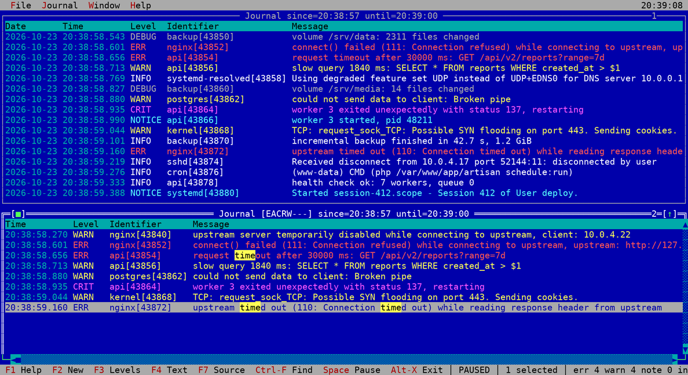

# TurboJedi

Turbo Journald Interface (J[e]DI) — a Turbo Vision viewer of the systemd journal. Every window is a journal client of its own:
its filter goes to the journal as a query, so a window of one unit or of errors only reads just those
entries, while other windows follow the whole system next to it.

Built on [magiblot/tvision](https://github.com/magiblot/tvision), libsystemd and PCRE2.



## Features

- Windows with journals and filters of their own: journals of this machine, of every machine or of a directory,
  levels, source (unit, identifier, command, transport, boot, user, machine, PID,
  any `FIELD=VALUE`), time range, and text, plain or a regular expression of PCRE2, to show or to leave out
- Follows the tail, Space pauses; scrolling above the first line brings the older entries in
- Columns to choose: date, time, level, host, unit, identifier, PID; UTC, milliseconds, wrapped messages
- Highlighting of messages by rules: built-in ones for times, addresses, identifiers, paths, quoted text, key=value
  and the words that matter, or any rule file of [grc](https://github.com/garabik/grc)
- Find with highlighting, next and previous, on into the older entries above the first line
- Clone of a window with its lines, filter, selection and place: one stays where it is, the other goes elsewhere;
  a timeline is cloned with its counts, step and scale
- Go to a time, and every other window to the time of the selected line: what happened elsewhere at that moment
- Details of an entry with all its fields, a field there opens a window narrowed to it
- Selection with the keyboard or the mouse, copy to the clipboard (OSC 52 over SSH), export to a file
- Timeline: entries of the filter of a window by intervals of time, errors, warnings and the rest stacked
  in a column per interval; a column takes every journal window to its time
- Layouts: all windows with their filters, columns and places, saved to and opened from INI files;
  the last one comes back on the next start

## Installation

Ready packages of every release are on the [releases page](https://github.com/cyanide-burnout/TurboJedi/releases/latest):
Debian 12 and 13, Ubuntu 24.04 and 26.04, Fedora 44, RHEL 9 and 10 (and their rebuilds) on amd64 and arm64, Arch Linux
on amd64. GitHub Actions builds each of them in a container of its distribution. The script takes the one that fits:

```
curl -fsSL https://raw.githubusercontent.com/cyanide-burnout/TurboJedi/master/install.sh | sh
```

It asks for sudo when not run as root, `TURBOJEDI_VERSION=0.6` before `sh` takes that release instead of the latest one.
Raspberry Pi OS of 64 bits is Debian on arm64 and has packages; on 32 bits (armhf) TurboJedi builds from the sources.
By hand:

```
sudo apt install ./turbojedi_<version>_<distribution>_<arch>.deb
sudo dnf install ./turbojedi-<version>-1.<dist>.<arch>.rpm
sudo pacman -U turbojedi-<version>-1-x86_64.pkg.tar.zst
```

Alpine has no systemd, so there is no journal to show. Elsewhere TurboJedi builds from the sources.

## Building

Debian packages: `build-essential cmake pkg-config libsystemd-dev libncurses-dev libpcre2-dev`, `libgpm-dev` for
the mouse in the Linux console, and `grc` for its rule files if they are wanted

```
git submodule update --init
make
sudo make install
```

`make` builds tvision in `Import/tvision/build` first. `make install` puts the executable to `/usr/local/bin`
and the manual page to `/usr/local/share/man/man1`, `PREFIX` and `DESTDIR` move them. Without libgpm the build
goes on, with the mouse in terminal emulators only; the mouse of the Linux console needs the `gpm` service running.

### Debian package

```
sudo apt install debhelper
make deb
```

`make deb` builds `turbojedi_<version>_<arch>.deb` and its `-dbgsym` next to the directory of the project, with
the files in `/usr`. The version comes from `git describe` the way the program shows it: `v0.1-3-gabcdef` becomes
`0.1+3+gabcdef`.

`make deb DISTRIBUTION=amd64` builds for another architecture, with the cross compilers and the libraries of
that architecture in place:

```
sudo dpkg --add-architecture amd64
sudo apt update
sudo apt install crossbuild-essential-amd64 libsystemd-dev:amd64 libncurses-dev:amd64 libpcre2-dev:amd64 libgpm-dev:amd64
```

### RPM package

```
sudo dnf install rpm-build gcc-c++ make cmake systemd-devel ncurses-devel pcre2-devel gpm-devel
make rpm
```

`make rpm` builds `rpmbuild/RPMS/<arch>/turbojedi-<version>-1.<dist>.<arch>.rpm` for Fedora and RHEL, with the
version the same way.

### Arch Linux package

```
sudo pacman -S --needed base-devel cmake git pkgconf gpm
make arch
```

`make arch` builds `arch/turbojedi-<version>-1-<arch>.pkg.tar.zst` with `makepkg`, as a user other than root.

### Packages of a release

A tag `v*` makes GitHub Actions build all the packages and put them to its release.

## Usage

```
turbojedi [options] [FIELD=VALUE ...]
```

| Option | |
|---|---|
| `-t`, `--identifier ID` | entries of `SYSLOG_IDENTIFIER` |
| `-u`, `--unit UNIT` | entries of a systemd unit, `.service` is assumed without a suffix |
| `-U`, `--user USER` | entries of a user, by name or number |
| `-p`, `--priority LEVEL` | entries up to `LEVEL`: `emerg` … `debug` or `0` … `7` |
| `-k`, `--kernel` | kernel messages only |
| `-S`, `--since TIME` | entries from `TIME` on |
| `--until TIME` | entries up to `TIME` |
| `-b`, `--boot` | entries of the current boot |
| `-D`, `--directory DIR` | journal files of `DIR` in the first window |
| `-m`, `--merge` | journals of every machine there are in the first window, like `journalctl --merge`: other machine IDs in `/var/log/journal` and `/var/log/journal/remote` of `systemd-journal-remote` |
| `-n`, `--lines N` | history to start with, 1000 by default |
| `-H`, `--highlight NAME` | highlighting rules: `builtin` (default), `off`, a rule file of grc such as `conf.log`, or a path |
| `-c`, `--layout FILE` | windows of a saved layout |
| `--clipboard-copy COMMAND` | command of `sh` that takes copied lines on its standard input, over `$TURBOJEDI_CLIPBOARD_COPY` |

`TIME` is `2026-10-23 19:00[:00]`, `2026-10-23`, `19:00`, `now`, `today`, `yesterday`, `tomorrow` or a relative
`-1h`, `+30m` (`s`, `m`, `h`, `d`).

Reading the whole journal needs root or the `systemd-journal` group, others see their own entries only.

Copy (Ctrl-Ins, and Copy in the details) goes to the clipboard of the terminal by OSC 52 or to a clipboard tool
of the desktop. A command of your own takes the lines instead, such as `remote-copy.sh` of
[RemoteClipboard](https://github.com/cyanide-burnout/RemoteClipboard) that brings them home over an SSH socket:

```
export TURBOJEDI_CLIPBOARD_COPY="$HOME/remote-copy.sh"
turbojedi
```

When the command exits with an error or does not finish in 3 seconds, the clipboard of the terminal takes the
lines as usual. Input lines of the dialogs keep the clipboard of Turbo Vision, pasting is up to the terminal.

Under `sudo` the command runs as root, while the clipboard belongs to you: `remote-copy.sh` looks for the socket
of `$USER`, and `sudo` leaves `TURBOJEDI_CLIPBOARD_COPY` and `SSH_TTY` out of the environment. Give the command
by the option and let it go back to your user, `sudo -u` sets `USER` and `HOME` of that user:

```
sudo turbojedi --clipboard-copy "sudo -u $USER $HOME/remote-copy.sh"
```

Your shell puts in `$USER` and `$HOME` before `sudo` starts.

## Keys

| Key | |
|---|---|
| F1 | keys |
| F2 | new window with the filter of the focused one |
| Shift-F2 | clone of the focused window: its lines, filter, find, selection and place, or the counts, step, scale and cursor of a timeline; both go on with the journal on their own |
| F3 | levels |
| F4 | text filter |
| F7 | source |
| Shift-F7 | journals: of this machine, of every machine or of a directory |
| Ctrl-T | time range |
| Ctrl-K | columns |
| Ctrl-W | wrap long messages |
| Ctrl-L | highlighting rules |
| Ctrl-F, Ctrl-N, Ctrl-P | find, next, previous |
| Ctrl-G | go to a time |
| Alt-G | every other window goes to the time of the selected line |
| Alt-Left, Alt-Backspace | back to where the window was before Ctrl-G, Alt-G or a find |
| Alt-T | timeline: entries of the filter of the window by intervals of time; Left and Right move, Enter takes every journal window to the interval, `+` and `-` change the step, `L` the scale |
| Enter, double click | details of the entry, Enter on a field there opens a window with it added to the filter |
| Space | pause or follow |
| Shift+arrows, mouse | select lines, Esc drops the selection |
| Ctrl-Ins | copy the selected lines or the screen |
| Ctrl-E | export the selected lines or all of them |
| F8 | clear the window |
| Ctrl-O, Ctrl-S | open, save a layout |
| F5, Ctrl-F5, F6, F9, Alt-F3 | zoom, size, next, tile, close |
| Alt-X | exit |

## Layouts

A layout is an INI file with a `[journal]` section per window of the journal (`[window]` in older layouts):

```
[journal]
bounds = 0 0 120 28
unit = nginx.service
text = timeout
regex = yes
levels = EACRW---
highlight = conf.log
columns = date,time,level,identifier,pid,millisecond
```

Keys: `bounds`, `directory`, `merge`, `unit`, `identifier`, `command`, `transport`, `boot`, `user`, `machine`, `pid`, `match` (repeatable),
`since`, `until`, `text`, `regex`, `exclude`, `case`, `levels` (letters `EACRWNID` of the levels shown, dashes
for the hidden ones), `highlight` and `columns` (`date`, `time`, `level`, `host`, `unit`, `identifier`, `pid`, `utc`,
`millisecond`, `wrap`).

A timeline is a `[timeline]` section with `bounds`, the keys of the filter it counts, `step` (seconds of an interval,
`0` lets the window choose one that fits) and `scale` (`linear` or `log`):

```
[timeline]
bounds = 0 28 120 42
unit = nginx.service
levels = EACRWNID
step = 3600
scale = log
```

## Highlighting

Rules are those of [grc](https://github.com/garabik/grc): `regexp=` with `colours=` for the match and its groups,
`count=once`, `more` or `stop`, entries apart by lines of `-` or `=`. Rule files come from `~/.grc`,
`/usr/local/share/grc` and `/usr/share/grc`, or by a path. Colors go over the color of the level, light ones for
the blue window; rules of several lines (`count=block`) and replacements are left out. The built-in rules are
written the same way in `Source/JournalHighlighter.cpp`.

## Last layout

On exit the layout is kept in `$XDG_CONFIG_HOME/turbojedi/last.jedi` (`~/.config/turbojedi/last.jedi`)
and opened on the next start, unless a layout or filter options are given.
