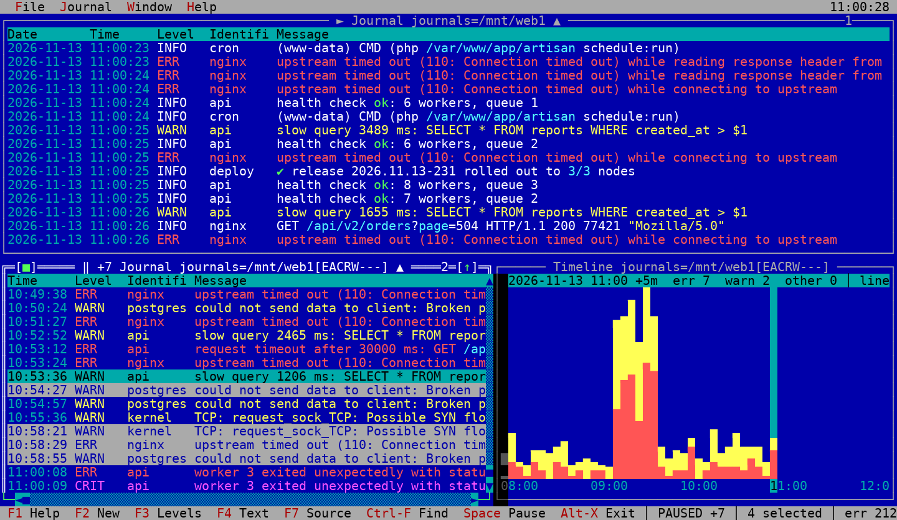

# TurboJedi

Turbo Journald Interface (J[e]DI) — a Turbo Vision viewer of the systemd journal. Every window is a journal client of its own:
its filter goes to the journal as a query, so a window of one unit or of errors only reads just those
entries, while other windows follow the whole system next to it.

Built on [magiblot/tvision](https://github.com/magiblot/tvision), libsystemd and PCRE2.



## Features

- Windows with journals and filters of their own: journals of this machine, of every machine or of a directory,
  one mounted from another machine over SSH or NFS as well,
  levels, source (unit, identifier, command, transport, boot, user, machine, PID,
  any `FIELD=VALUE`), time range, and text, plain or a regular expression of PCRE2, to show or to leave out
- Follows the tail, Space pauses; scrolling past the oldest line brings the older entries in. The title of every
  window tells it: ► follows, ‖ is paused, ‖ +12 has 12 entries come meanwhile; a click on the sign pauses or follows.
  A paused window that is full keeps
  its lines and marks, the new entries are counted and come in when it follows again
- The newest entries at the bottom or on top, like `journalctl --reverse`, for every window of its own; the lines of
  a message stay under it, the title ends with ▲ or ▼ and a click on it turns the order
- Columns to choose: date, time, level, host, unit, identifier, PID; UTC, milliseconds, wrapped messages, hidden heading,
  the newest on top
- Highlighting of messages by rules: built-in ones for times, addresses, identifiers, paths, quoted text, key=value
  and the words that matter, or any rule file of [grc](https://github.com/garabik/grc); colors of the escape sequences
  a message comes with are shown under the rules, the rest of the sequences are taken out
- Find with highlighting, next and previous, on into the older entries past the oldest line
- Clone of a window with its lines, filter, selection and place: one stays where it is, the other goes elsewhere;
  a timeline is cloned with its counts, step and scale
- List of the windows to go to, narrowed down by a filter
- Go to a time, and every other window to the time of the selected line: what happened elsewhere at that moment
- Details of an entry with all its fields, a field there opens a window narrowed to it
- Selection with the keyboard or the mouse, copy to the clipboard (OSC 52 over SSH), export to a file
- Timeline: entries of the filter of a window by intervals of time, errors, warnings and the rest stacked
  in a column per interval; a column takes every journal window to its time
- Layouts: all windows with their filters, columns and places, saved to and opened from INI files;
  the last one comes back on the next start
- Check for updates in the Help menu: asks GitHub for the latest release only when chosen, shows it
  with the command of the install script; nothing goes to the network otherwise. Its answer has the choice
  of a check on start, once a day and only about a newer release, kept in `$XDG_CONFIG_HOME/turbojedi/update.ini`

## Installation

Ready packages of every release are on the [releases page](https://github.com/cyanide-burnout/TurboJedi/releases/latest):
Debian 12 and 13, Ubuntu 22.04, 24.04 and 26.04, Fedora 44, RHEL 9 and 10 (and their rebuilds), Amazon Linux 2023,
openSUSE Tumbleweed and Leap 16 on amd64 and arm64, Arch Linux on amd64. GitHub Actions builds each of them in a container
of its distribution. The script takes the one that fits:

```
curl -fsSL https://raw.githubusercontent.com/cyanide-burnout/TurboJedi/master/install.sh | sh
```

It asks for sudo when not run as root, `TURBOJEDI_VERSION=0.6` before `sh` takes that release instead of the latest one.
Run again, it updates TurboJedi and leaves it alone when that release is installed already. After an upgrade of the
distribution it puts the package of the same release built for the new one; Check for updates tells about it as well.
Raspberry Pi OS of 64 bits is Debian on arm64 and has packages; on 32 bits (armhf) TurboJedi builds from the sources.
By hand:

```
sudo apt install ./turbojedi_<version>_<distribution>_<arch>.deb
sudo dnf install ./turbojedi-<version>-1.<dist>.<arch>.rpm
sudo zypper install --allow-unsigned-rpm ./turbojedi-<version>-1.<tumbleweed|leap16>.<arch>.rpm
sudo pacman -U turbojedi-<version>-1-x86_64.pkg.tar.zst
```

Alpine has no systemd, so there is no journal to show. Elsewhere TurboJedi builds from the sources.

## Building

Debian packages: `build-essential cmake pkg-config libsystemd-dev libncurses-dev libpcre2-dev`, `libgpm-dev` for
the mouse in the Linux console, `libcurl4-openssl-dev` for Check for updates, and `grc` for its rule files if they are wanted

```
git submodule update --init
make
sudo make install
```

A clone is updated with its submodule, a plain `git pull` leaves tvision where it was until
`git submodule update --init`:

```
git pull --recurse-submodules
make
```

`make` builds tvision in `Import/tvision/build` first, and again what has changed in it after the submodule has
moved. `make install` puts the executable to `/usr/local/bin` and the manual page to `/usr/local/share/man/man1`,
`PREFIX` and `DESTDIR` move them. Without libgpm the build goes on, with the mouse in terminal emulators only; the mouse
of the Linux console needs the `gpm` service running.
Without libcurl the Help menu has no Check for updates.

About, `--help` and Check for updates link to the repository on GitHub the clone comes from, its `origin`, so a fork links
to itself and checks its own releases. A copy without git or a clone of another host has none, `make REPOSITORY=` leaves
it out on purpose and `make REPOSITORY=https://github.com/owner/name` names another one.

### Debian package

```
sudo apt install debhelper
make deb
```

`make deb` builds `turbojedi_<version>_<arch>.deb` and its `-dbgsym` next to the directory of the project, with
the files in `/usr`. The version comes from `git describe` the way the program shows it: `v0.1-3-gabcdef` becomes
`0.1+3+gabcdef`.

`make deb DISTRIBUTION=amd64` builds for another architecture, with the cross compilers and the libraries of
that architecture in place:

```
sudo dpkg --add-architecture amd64
sudo apt update
sudo apt install crossbuild-essential-amd64 libsystemd-dev:amd64 libncurses-dev:amd64 libpcre2-dev:amd64 libgpm-dev:amd64 libcurl4-openssl-dev:amd64
```

### RPM package

```
sudo dnf install rpm-build gcc-c++ make cmake systemd-devel ncurses-devel pcre2-devel gpm-devel libcurl-devel
make rpm
```

`make rpm` builds `rpmbuild/RPMS/<arch>/turbojedi-<version>-1.<dist>.<arch>.rpm` for Fedora, RHEL and Amazon Linux,
with the version the same way. openSUSE takes the same packages from `zypper` and `gcc-PIE`, gives no tag of its own
and gets it by `make rpm DIST=tumbleweed` or `DIST=leap16`.

### Arch Linux package

```
sudo pacman -S --needed base-devel cmake git pkgconf gpm curl
make arch
```

`make arch` builds `arch/turbojedi-<version>-1-<arch>.pkg.tar.zst` with `makepkg`, as a user other than root.

### Packages of a release

A tag `v*` makes GitHub Actions build all the packages and put them to its release. The notes of the release are the
section of [CHANGELOG.md](CHANGELOG.md) for its version, written before the tag.

## Usage

```
turbojedi [options] [FIELD=VALUE ...]
```

| Option | |
|---|---|
| `-t`, `--identifier ID` | entries of `SYSLOG_IDENTIFIER` |
| `-u`, `--unit UNIT` | entries of a systemd unit, `.service` is assumed without a suffix |
| `-U`, `--user USER` | entries of a user, by name or number |
| `-p`, `--priority LEVEL` | entries up to `LEVEL`: `emerg` … `debug` or `0` … `7` |
| `-k`, `--kernel` | kernel messages only |
| `-S`, `--since TIME` | entries from `TIME` on |
| `--until TIME` | entries up to `TIME` |
| `-b`, `--boot` | entries of the current boot |
| `-D`, `--directory DIR` | journal files of `DIR` in the first window |
| `-m`, `--merge` | journals of every machine there are in the first window, like `journalctl --merge`: other machine IDs in `/var/log/journal` and `/var/log/journal/remote` of `systemd-journal-remote` |
| `-n`, `--lines N` | history to start with, 1000 by default |
| `-r`, `--reverse` | the newest entries on top in the first window, like `journalctl --reverse` |
| `-H`, `--highlight NAME` | highlighting rules: `builtin` (default), `off`, a rule file of grc such as `conf.log`, or a path |
| `-c`, `--layout FILE` | windows of a saved layout |
| `--clipboard-copy COMMAND` | command of `sh` that takes copied lines on its standard input, over `$TURBOJEDI_CLIPBOARD_COPY` |

`TIME` is `2026-10-23 19:00[:00]`, `2026-10-23`, `19:00`, `now`, `today`, `yesterday`, `tomorrow` or a relative
`-1h`, `+30m` (`s`, `m`, `h`, `d`).

Reading the whole journal needs root or the `systemd-journal` group, others see their own entries only.

Copy (Ctrl-Ins, and Copy in the details) goes to the clipboard of the terminal by OSC 52 or to a clipboard tool
of the desktop. A command of your own takes the lines instead, such as `remote-copy.sh` of
[RemoteClipboard](https://github.com/cyanide-burnout/RemoteClipboard) that brings them home over an SSH socket:

```
export TURBOJEDI_CLIPBOARD_COPY="$HOME/remote-copy.sh"
turbojedi
```

When the command exits with an error or does not finish in 3 seconds, the clipboard of the terminal takes the
lines as usual. Input lines of the dialogs keep the clipboard of Turbo Vision, pasting is up to the terminal.

Under `sudo` the command runs as root, while the clipboard belongs to you: `remote-copy.sh` looks for the socket
of `$USER`, and `sudo` leaves `TURBOJEDI_CLIPBOARD_COPY` and `SSH_TTY` out of the environment. Give the command
by the option and let it go back to your user, `sudo -u` sets `USER` and `HOME` of that user:

```
sudo turbojedi --clipboard-copy "sudo -u $USER $HOME/remote-copy.sh"
```

Your shell puts in `$USER` and `$HOME` before `sudo` starts.

## Journals of other machines

A journal directory mounted from another machine opens with `-D` or Shift-F7 like any other directory, with the filters,
the history, the timeline, the details and Alt-G. `/var/log/journal` opens as it is, with the directories of machine IDs
in it; a machine that keeps its journal in memory only (`Storage=volatile`) has it in `/run/log/journal`. A network file
system or FUSE tells nothing about appended entries and new files, TurboJedi looks at the files every second instead and
opens the journal again after a rotation.

Over SSH with sshfs, as a user of the group `systemd-journal` on that machine or as root:

```
mkdir -p ~/journals/web1
sshfs -o ro,reconnect,cache=no,ServerAliveInterval=15 admin@web1:/var/log/journal ~/journals/web1
turbojedi -D ~/journals/web1
fusermount -u ~/journals/web1
```

`cache=no` lets the appended entries in at once, sshfs keeps what it knows about a file for 20 seconds otherwise and they
come in by those steps. With `reconnect` the files open before the connection broke cannot be read anymore, the windows
open their journals again when it is back and go on after their last lines.

Over NFS, exported read-only by that machine in `/etc/exports`:

```
/var/log/journal  monitor.example.com(ro,no_subtree_check)
```

and mounted where TurboJedi runs:

```
sudo mkdir -p /mnt/journals/web1
sudo mount -t nfs -o ro web1:/var/log/journal /mnt/journals/web1
turbojedi -D /mnt/journals/web1
```

The files are `root:systemd-journal` with mode 0640 and NFS compares numbers: the user who reads them needs a group with
the GID `systemd-journal` has on that machine, root reads them only with `no_root_squash` in the export. A mount of NFS is
`hard` unless told otherwise: while the server is away, and during its grace period of 90 seconds after a start, the windows
wait for it the way every program on that mount does, and go on when it answers.

A window per machine, each with its directory chosen by Shift-F7, puts several machines side by side: Alt-G takes every
window to the time of the selected line, and a layout keeps their directories for the next start.

## Keys

| Key | |
|---|---|
| F1 | keys |
| F2 | new window with the filter of the command line |
| Shift-F2 | clone of the focused window: its lines, filter, find, selection and place, or the counts, step, scale and cursor of a timeline; both go on with the journal on their own |
| F3 | levels |
| F4 | text filter |
| F7 | source |
| Shift-F7 | journals: of this machine, of every machine or of a directory |
| Ctrl-T | time range |
| Ctrl-K | columns |
| Ctrl-W | wrap long messages |
| Ctrl-R | the newest entries on top or at the bottom; the title ends with ▲ when they are at the bottom, ▼ when on top, a click on it turns the order too |
| Ctrl-L | highlighting rules |
| Ctrl-F, Ctrl-N, Ctrl-P | find, next, previous |
| Ctrl-G | go to a time |
| Alt-G | every other window goes to the time of the selected line |
| Alt-Left, Alt-Backspace | back to where the window was before Ctrl-G, Alt-G or a find |
| Alt-Right | forward again where Back has come from; a new jump after Back drops the way ahead, as in a browser |
| Alt-T | timeline: entries of the filter of the window by intervals of time; Left and Right move, Enter takes every journal window to the interval, `+` and `-` change the step, `L` the scale |
| Up, Down, PgUp, PgDn, Home, End | move the cursor, it comes on the newest row of the screen first; on the newest line the window follows, anywhere else it pauses |
| Enter, double click | details of the entry under the cursor, Enter on a field there opens a window with it added to the filter |
| Space | pause or follow, also a click on ► or ‖ in the title |
| Shift+arrows, mouse | select lines from the cursor, Esc drops the cursor, the selection and the marks |
| M, Insert | begin marking from the cursor, the keys mark the lines they pass; M again ends it and they stay marked, so lines apart are marked one stroke after another. Begun on a marked line it takes the marks off instead. No Shift is needed, which Terminal of macOS and some others keep for themselves |
| Click | put the cursor on a line, the marks stay; in a stroke of M the click goes on with it as the keys do. Ctrl+click marks a line or takes its mark off, Shift+click and dragging select |
| Ctrl-Ins | copy the selected lines, the line under the cursor or the screen |
| Ctrl-E | export the selected lines or all of them |
| F8 | clear the window |
| Ctrl-O, Ctrl-S | open, save a layout; both start at the layout opened or saved last, Save offers its file again |
| F5, Ctrl-F5, F6, F9, Alt-F3 | zoom, size, next, tile, close |
| Alt-0 | list of the windows to go to, the one used before is under the cursor |
| Alt-X | exit |

## Layouts

A layout is an INI file with a `[journal]` section per window of the journal (`[window]` in older layouts):

```
[journal]
bounds = 0 0 120 28
unit = nginx.service
text = timeout
regex = yes
levels = EACRW---
highlight = conf.log
columns = date,time,level,identifier,pid,millisecond
```

Keys: `bounds`, `directory`, `merge`, `unit`, `identifier`, `command`, `transport`, `boot`, `user`, `machine`, `pid`, `match` (repeatable),
`since`, `until`, `text`, `regex`, `exclude`, `case`, `levels` (letters `EACRWNID` of the levels shown, dashes
for the hidden ones), `highlight` and `columns` (`date`, `time`, `level`, `host`, `unit`, `identifier`, `pid`, `utc`,
`millisecond`, `wrap`, `headless`, `reverse`).

A timeline is a `[timeline]` section with `bounds`, the keys of the filter it counts, `step` (seconds of an interval,
`0` lets the window choose one that fits) and `scale` (`linear` or `log`):

```
[timeline]
bounds = 0 28 120 42
unit = nginx.service
levels = EACRWNID
step = 3600
scale = log
```

## Highlighting

Rules are those of [grc](https://github.com/garabik/grc): `regexp=` with `colours=` for the match and its groups,
`count=once`, `more` or `stop`, entries apart by lines of `-` or `=`. Rule files come from `~/.grc`,
`/usr/local/share/grc` and `/usr/share/grc`, or by a path. Colors go over the color of the level, light ones for
the blue window; rules of several lines (`count=block`) and replacements are left out. The built-in rules are
written the same way in `Source/JournalHighlighter.cpp`.

## Last layout

On exit the layout is kept in `$XDG_CONFIG_HOME/turbojedi/last.jedi` (`~/.config/turbojedi/last.jedi`)
and opened on the next start, unless a layout or filter options are given.
